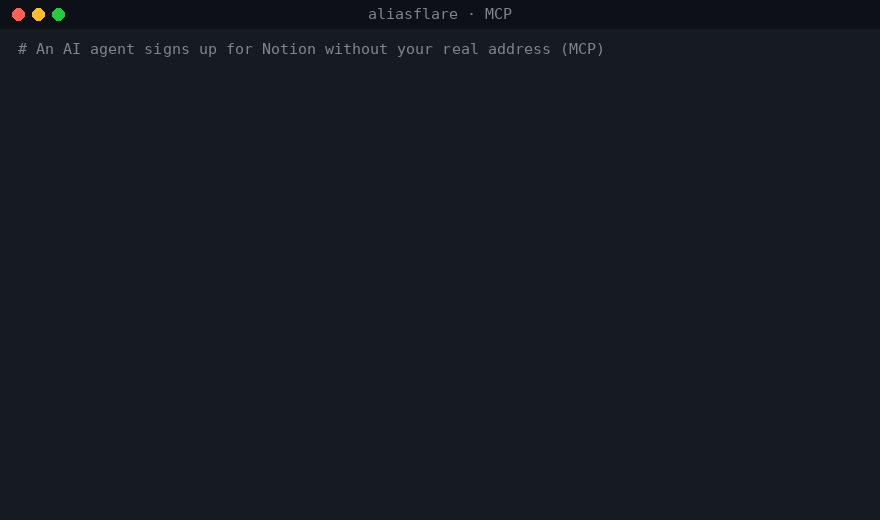

# aliasflare

**Don't want to hand your real email to every website, and don't want to pay for an alias service?** aliasflare is a self-hosted alias mailbox that runs on your own Cloudflare account's free tier.

Unlike SimpleLogin or addy.io, aliases are unlimited, you keep your own domain for free, and nothing lives on someone else's server. A different address for every website, all landing in your real inbox. Turn any of them off in one click when the spam starts. Reply as the alias, so your real address never leaks. Verification codes are pulled into the subject line, tracking pixels are stripped, and AI agents can create aliases and read codes through MCP.

[](https://deploy.workers.cloudflare.com/?url=https://github.com/charleswei118/aliasflare)

[中文说明](README.zh-CN.md)



<sub>Real output of aliasflare v0.2.0 run locally with demo data (`example.com`).</sub>

## Why

| | SimpleLogin free | addy.io free | **aliasflare** |
|---|---|---|---|
| Aliases | 10 | unlimited on username, 10 shared | **unlimited** |
| Your own domain | paid | paid | **yes** |
| Bandwidth | unlimited | 10 MB / month | **unlimited inbound** |
| Reply from alias | yes | paid | **yes** (optional: free Resend account, or Workers Paid) |
| Your data | their servers | their servers | **your Cloudflare account** |
| Cost | $0, then $36/yr | $0, then $12–36/yr | **$0** |

## Features

- **Unlimited aliases** on one or more of your domains. Create them in the dashboard, or just make one up when signing up — `anything@yourdomain.com` is created on first mail (turn off with `AUTO_CREATE=false`).
- **One-click disable.** A disabled alias rejects mail as if it never existed.
- **Sender hidden, reply as alias.** Each message arrives `From: "Shop (news at shop.com)" <shop.k3f9@yourdomain.com>` with a private `Reply-To`. Hit reply in Gmail and the answer goes out from the alias; your real address is scrubbed from the body too.
- **Send new mail from any alias** (dashboard, API or MCP).
- **Verification codes** detected in Chinese, English, Japanese, Korean and more, and put into the subject: `[482913] Your login code`.
- **Tracking pixels removed** (1×1 images, hidden images, known trackers).
- **MCP server** at `/mcp`: `create_alias`, `get_latest_code`, `list_aliases`, `set_alias_enabled`, `recent_messages`, `send_from_alias`. Let your agent sign up for things without your inbox.
- **Never loses mail.** If rewriting fails for any reason the original is forwarded as-is.
- **Small and auditable.** ~1,000 lines of plain JavaScript, one dependency (`postal-mime`), D1 stores only metadata (no message bodies).

## Deploy (about 5 minutes)

You need a domain on Cloudflare.

1. **Email Routing on.** Cloudflare Dashboard → your domain → **Email** → **Email Routing** → enable it (Cloudflare adds the MX records). Under **Destination addresses**, add your real inbox and click the verification link.
2. **Click the button** above. Cloudflare copies this repo to your GitHub, creates the D1 database and asks for:
   - `DOMAIN` — e.g. `example.com` (comma-separate several)
   - `DESTINATION` — your verified real inbox
   - `ADMIN_TOKEN` — a long random password (`openssl rand -hex 24`)
   - `RESEND_API_KEY` — optional, see below; `none` to skip
3. **Route mail to the Worker.** Email Routing → **Routing rules** → **Catch-all address** → action **Send to a Worker** → `aliasflare` → enable.

Open your Worker's URL, log in with `ADMIN_TOKEN`, and create your first alias.

### Replying for free

Receiving and forwarding to your own verified inbox is free on every Cloudflare plan. Sending to *other* people (replies, new mail) needs one of:

- **Resend** (recommended, free 3,000 emails/month, 100/day): sign up at [resend.com](https://resend.com), add and verify your domain, create an API key, set it as `RESEND_API_KEY`.
- **Brevo** (free, 300 emails/day): sign up at [brevo.com](https://brevo.com), verify your sending domain (add the DNS records it gives you), create an API key, set it as `BREVO_API_KEY` (optional, no need to fill `none`). Used when `RESEND_API_KEY` isn't set.
  Deliverability depends on your domain's reputation: a brand-new Brevo free account sending from a free subdomain (e.g. `*.dpdns.org`) may land in Outlook's junk folder or be rejected by Gmail. A domain you own and real, low-volume replies help.
- **Cloudflare Email Sending** on Workers Paid ($5/month, 3,000 emails included): onboard your domain under Email Sending and leave `RESEND_API_KEY=none`.

Without either, everything except replying and sending works.

### Manual deploy

```bash
git clone https://github.com/charleswei118/aliasflare && cd aliasflare
npm install
npx wrangler d1 create aliasflare        # wrangler can also create it on first deploy
for s in DOMAIN DESTINATION ADMIN_TOKEN RESEND_API_KEY; do npx wrangler secret put $s; done
npm run deploy                            # applies migrations, then deploys
```

Then do step 3 above.

## Settings

Secrets: `DOMAIN`, `DESTINATION`, `ADMIN_TOKEN`, `RESEND_API_KEY`.
Variables in `wrangler.toml`:

| Variable | Default | What it does |
|---|---|---|
| `AUTO_CREATE` | `true` | Create aliases on first incoming mail |
| `FORWARD_MODE` | `rewrite` | `forward` = plain forwarding, no sender hiding or replies |
| `BLOCK_TRACKERS` | `true` | Strip tracking pixels |
| `CODE_IN_SUBJECT` | `true` | Prefix the subject with a detected code |
| `BANNER` | `true` | One-line header showing alias and real sender |

## Use with AI agents (MCP)

```json
{
  "mcpServers": {
    "aliasflare": {
      "url": "https://aliasflare.<you>.workers.dev/mcp",
      "headers": { "Authorization": "Bearer <ADMIN_TOKEN>" }
    }
  }
}
```

Then: *"Sign me up for the Notion newsletter with a new alias and confirm it."* The agent calls `create_alias(note="notion")`, uses the address, then `get_latest_code`.


### Local stdio MCP (Claude Desktop, Cursor, …)

If your client only speaks stdio, run the bundled bridge. It answers `tools/list` locally and forwards tool calls to your own Worker:

```json
{
  "mcpServers": {
    "aliasflare": {
      "command": "npx",
      "args": ["-y", "github:charleswei118/aliasflare"],
      "env": { "ALIASFLARE_URL": "https://aliasflare.<you>.workers.dev", "ALIASFLARE_TOKEN": "<ADMIN_TOKEN>" }
    }
  }
}
```

A `Dockerfile` for the same bridge is included.

## REST API

All endpoints need `Authorization: Bearer <ADMIN_TOKEN>`.

| Method | Path | Body / query |
|---|---|---|
| GET | `/api/config` | |
| GET | `/api/aliases` | `?q=` |
| POST | `/api/aliases` | `{note}` or `{local, domain}` or `{address}` |
| PATCH | `/api/aliases/:id` | `{enabled, note}` |
| DELETE | `/api/aliases/:id` | |
| GET | `/api/messages` | `?alias_id=&limit=` |
| GET | `/api/code` | `?alias=&since=` (minutes) |
| POST | `/api/send` | `{alias, to, subject, text}` |

## How it works

```
stranger ──▶ shop.k3f9@you.com ──▶ Worker ──▶ you@gmail.com
                                   From: "Shop (news at shop.com)" <shop.k3f9@you.com>
                                   Reply-To: reply+<token>@you.com

you@gmail.com ──▶ reply+<token>@you.com ──▶ Worker ──▶ stranger
                                            From: shop.k3f9@you.com
```

Only mail from your `DESTINATION` (and not failing SPF/DMARC) may use a `reply+` address.

## Limits

- Cloudflare Email Routing: 25 MiB per message. The catch-all rule means the 200-rule limit does not apply.
- Free Workers plan: 100,000 requests/day and 10 ms CPU per invocation; very large messages with many attachments may exceed CPU on the free plan and fall back to plain forwarding.
- Cloudflare Email Sending is in beta.

## Development

```bash
npm test     # node:test, uses node:sqlite as a D1 stand-in
npm run dev
```

## Troubleshooting

- **Mail isn't arriving.** Check Email Routing → Routing rules: the catch-all must be set to *Send to a Worker* → `aliasflare` and enabled.
- **Nothing is forwarded.** `DESTINATION` must be a verified address under Email Routing → Destination addresses.
- **Replies fail or land in spam.** Check `/api/config`: `outbound` should be `resend`, `brevo` or `cloudflare`. A brand-new sending domain has little reputation; use a domain you own and keep volume low.
- **Alias rejected.** It may be disabled, or `AUTO_CREATE=false` and the alias doesn't exist yet.
- **Still stuck?** Open an issue with what `/health` and `/api/config` return (never paste your `ADMIN_TOKEN`).

## Hardening

Incoming mail never touches HTTP: Email Routing hands each message straight to the Worker's `email()` handler. The HTTP side only serves the admin UI, REST API and MCP, so you can lock it down without breaking mail:

- Set `workers_dev = false` in `wrangler.toml` and serve the admin side only on a [Custom Domain](https://developers.cloudflare.com/workers/configuration/routing/custom-domains/) of yours (redeploy after the change). Preview/version URLs are a separate setting.
- Put that hostname behind [Cloudflare Access](https://developers.cloudflare.com/workers/configuration/cloudflare-access/) (Zero Trust free tier), or add a [WAF rate limiting rule](https://developers.cloudflare.com/waf/rate-limiting-rules/) on it. Both act before the Worker runs; requests blocked by WAF, DDoS protection or other security features don't count as Worker requests.
- Worst case on the free plan: past 100,000 requests/day the Worker returns error 1027 until the counter resets at 00:00 UTC. It stops, it doesn't bill you.

## License

MIT

Looking for an MCP gateway for Chinese public data? See [web2mcp](https://github.com/charleswei118/web2mcp).
