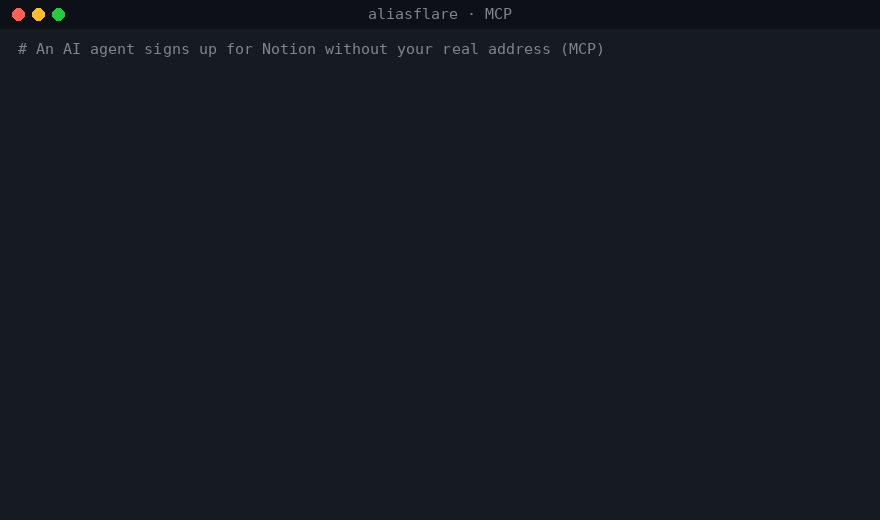

# aliasflare

**自建版 SimpleLogin / addy.io，跑在 Cloudflare 免费套餐上：一键部署 + 两步邮件路由设置，约 5 分钟。**

每个网站一个邮箱地址，全部转到你的真实邮箱；哪个开始发垃圾邮件，一键停用。用别名身份回信，真实地址永不泄露。验证码自动提到标题里，追踪像素自动去掉，AI 也能通过 MCP 自己开别名、读验证码。

[](https://deploy.workers.cloudflare.com/?url=https://github.com/charleswei118/aliasflare)

[English](README.md)



<sub>aliasflare v0.2.0 本地运行的真实输出，数据为演示数据（`example.com`）。</sub>

## 对比

| | SimpleLogin 免费版 | addy.io 免费版 | **aliasflare** |
|---|---|---|---|
| 别名数量 | 10 个 | 用户名下不限，共享域名 10 个 | **不限** |
| 自有域名 | 付费 | 付费 | **支持** |
| 流量 | 不限 | 每月 10 MB | **收信不限** |
| 用别名回信 | 支持 | 付费 | **支持**（可选：免费 Resend 账号，或 Workers 付费版） |
| 数据在哪 | 对方服务器 | 对方服务器 | **你自己的 Cloudflare 账户** |
| 费用 | 0，之后 $36/年 | 0，之后 $12–36/年 | **0 元** |

## 功能

- **不限数量的别名**，支持多个域名。可在面板里创建，也可以注册时随手编一个：`任意名字@你的域名` 收到第一封信时自动创建（`AUTO_CREATE=false` 可关闭）。
- **一键停用**：停用后来信直接退回，就像地址不存在。
- **隐藏发件人、以别名回信**：来信显示为 `"Shop (news at shop.com)" <shop.k3f9@你的域名>`，在 Gmail 里直接点回复，信就以别名发出，正文里的真实地址也会被替换掉。
- **用任意别名发新邮件**（面板、API、MCP 均可）。
- **验证码提取**：支持中、英、日、韩等，自动放进标题，如 `[482913] 登录验证`。
- **去除追踪像素**（1×1 图片、隐藏图片、常见追踪域名）。
- **MCP 服务** `/mcp`：`create_alias`、`get_latest_code`、`list_aliases`、`set_alias_enabled`、`recent_messages`、`send_from_alias`，让 AI 帮你注册网站而不暴露邮箱。
- **不丢信**：改写失败时原样转发。
- **小而透明**：约 1000 行原生 JavaScript，只依赖 `postal-mime`；D1 只存元数据，不存邮件正文。

## 部署（约 5 分钟）

前提：有一个托管在 Cloudflare 的域名。

1. **开启邮件路由**：Cloudflare 控制台 → 你的域名 → **电子邮件** → **电子邮件路由** → 启用（会自动加 MX 记录）。在 **目标地址** 里添加你的真实邮箱并点验证链接。
2. **点上面的一键部署按钮**。Cloudflare 会把仓库复制到你的 GitHub、自动创建 D1 数据库，并让你填写：
   - `DOMAIN`：如 `example.com`（多个用逗号分隔）
   - `DESTINATION`：已验证的真实邮箱
   - `ADMIN_TOKEN`：一串长随机密码（`openssl rand -hex 24`）
   - `RESEND_API_KEY`：可选，见下文；不用填 `none`
3. **把邮件交给 Worker**：电子邮件路由 → **路由规则** → **Catch-all 地址** → 操作选 **发送到 Worker** → 选 `aliasflare` → 启用。

打开 Worker 地址，用 `ADMIN_TOKEN` 登录，就能创建第一个别名。

### 免费回信

收信并转发到你自己已验证的邮箱，在所有 Cloudflare 套餐上都免费。要发给**别人**（回信、发新信）需要二选一：

- **Resend**（推荐，免费每月 3000 封、每天 100 封）：在 [resend.com](https://resend.com) 注册，添加并验证域名，创建 API Key，填到 `RESEND_API_KEY`。
- **Brevo**（免费，每天 300 封）：在 [brevo.com](https://brevo.com) 注册，验证发件域名（按它给的记录添加 DNS），创建 API Key，填到 `BREVO_API_KEY`（可选，不用填 `none`）。未设置 `RESEND_API_KEY` 时使用。
  送达率取决于域名信誉：新注册的 Brevo 免费账号配免费子域名（如 `*.dpdns.org`），可能进 Outlook 垃圾箱或被 Gmail 拒收。用自己的域名、少量真实回信会好很多。
- **Cloudflare Email Sending**：需要 Workers 付费版（每月 $5，含 3000 封），在 Email Sending 里接入域名，`RESEND_API_KEY` 填 `none`。

两者都不配，除回信和发信外的功能都能用。

### 手动部署

```bash
git clone https://github.com/charleswei118/aliasflare && cd aliasflare
npm install
for s in DOMAIN DESTINATION ADMIN_TOKEN RESEND_API_KEY; do npx wrangler secret put $s; done
npm run deploy    # 先执行数据库迁移，再部署
```

然后完成上面第 3 步。

## 配置项

密钥：`DOMAIN`、`DESTINATION`、`ADMIN_TOKEN`、`RESEND_API_KEY`。`wrangler.toml` 变量：

| 变量 | 默认 | 作用 |
|---|---|---|
| `AUTO_CREATE` | `true` | 收到信时自动创建别名 |
| `FORWARD_MODE` | `rewrite` | `forward` = 纯转发，不隐藏发件人、不能回信 |
| `BLOCK_TRACKERS` | `true` | 去除追踪像素 |
| `CODE_IN_SUBJECT` | `true` | 标题前加验证码 |
| `BANNER` | `true` | 正文顶部显示别名和真实发件人 |

## 接入 AI（MCP）

```json
{
  "mcpServers": {
    "aliasflare": {
      "url": "https://aliasflare.<你的子域>.workers.dev/mcp",
      "headers": { "Authorization": "Bearer <ADMIN_TOKEN>" }
    }
  }
}
```

然后对 AI 说：“用新别名帮我注册 Notion 并完成邮箱验证。”它会调用 `create_alias(note="notion")`，用这个地址注册，再调用 `get_latest_code` 取验证码。


### 本地 stdio MCP（Claude Desktop、Cursor 等）

客户端只支持 stdio 时，用自带的桥接程序：`tools/list` 本地应答，工具调用转发到你自己的 Worker。

```json
{
  "mcpServers": {
    "aliasflare": {
      "command": "npx",
      "args": ["-y", "github:charleswei118/aliasflare"],
      "env": { "ALIASFLARE_URL": "https://aliasflare.<you>.workers.dev", "ALIASFLARE_TOKEN": "<ADMIN_TOKEN>" }
    }
  }
}
```

仓库里也带了同一个桥接程序的 `Dockerfile`。

## 限制

- Cloudflare 邮件路由单封上限 25 MiB；用 Catch-all 规则，不受 200 条规则上限影响。
- Workers 免费版每天 10 万次请求、每次 10 ms CPU；附件很多的大邮件可能超出 CPU，会自动退回原样转发。
- Cloudflare Email Sending 目前是 Beta。

## 许可

MIT
